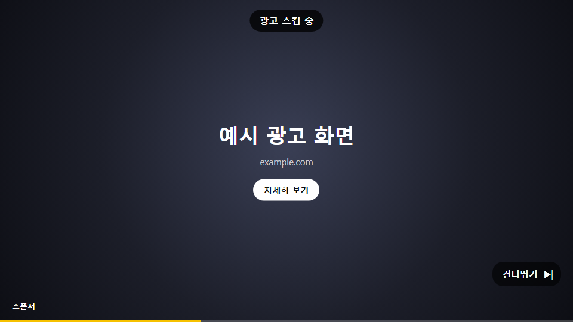
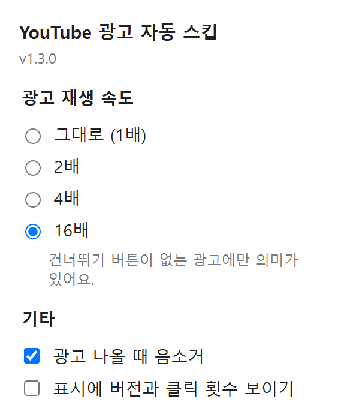

# youtube-ad-skipper

유튜브 광고 건너뛰기 버튼을 대신 눌러주고 배속을 걸 수 있게 해주는 크롬 확장 프로그램

밥 먹으면서 유튜브를 보다가 광고가 뜰 때마다 손을 뻗어 "건너뛰기"를 누르기 귀찮아서 만들었습니다.

위 이미지는 화면 구성을 보여주기 위한 예시입니다. 실제 광고는 유튜브 플레이어 안에서 재생되고, "광고 스킵 중" 표시가 그 위에 뜹니다.

## 하는 일

광고가 나오면 아래 일을 자동으로 합니다.

1. 건너뛰기 버튼이 보이면 1초 안에 눌러서 광고를 넘깁니다.
2. 광고가 나오는 동안 소리를 끄고 배속을 겁니다. 건너뛰기 버튼이 없는 광고도 빨리 끝납니다.
3. 플레이어 위쪽 가운데에 "광고 스킵 중" 표시를 띄웁니다.
4. 광고가 끝나면 음소거와 재생 속도를 원래대로 돌려놓습니다.

## 설정

툴바의 확장 아이콘을 누르면 설정 창이 열립니다. 바꾸면 바로 저장되고, 열려 있는 유튜브 탭에도 새로고침 없이 적용됩니다.

| 항목 | 기본값 | 설명 |
| --- | --- | --- |
| 광고 재생 속도 | 16배 | 1배, 2배, 4배, 16배 중에서 고릅니다. 1배면 재생 속도를 건드리지 않습니다. |
| 광고 나올 때 음소거 | 켬 | 끄면 광고 소리가 그대로 나옵니다. |
| 표시에 버전과 클릭 횟수 보이기 | 끔 | 동작이 이상할 때 켜서 확인하는 용도입니다. |

## 설치

크롬 웹 스토어에는 올리지 않았습니다. 폴더를 직접 불러오는 방식으로 설치합니다.

1. 이 저장소를 내려받거나 클론합니다.
2. 크롬 주소창에 `chrome://extensions`를 입력합니다.
3. 오른쪽 위의 **개발자 모드**를 켭니다.
4. **압축해제된 확장 프로그램을 로드합니다**를 누르고, `manifest.json`이 들어 있는 폴더를 고릅니다.
5. 열려 있던 유튜브 탭을 새로고침합니다.

크롬은 고른 폴더에서 확장을 바로 읽어 쓰기 때문에, 설치한 뒤에도 폴더를 지우거나 옮기면 안 됩니다.

코드를 고친 뒤에는 확장 페이지에서 새로고침(↻)을 누르고, 유튜브 탭도 새로고침해야 반영됩니다. 탭을 그대로 두면 예전 스크립트가 남아서 계속 돕니다.

## 동작 방식

처음에는 스크립트에서 버튼에 `click()`을 호출했는데, 유튜브가 이 클릭을 무시했습니다. 스크립트가 만든 클릭에는 `isTrusted = false`가 붙어서 사람이 누른 클릭과 구별되기 때문으로 보입니다.

그래서 지금은 크롬 디버거로 실제 마우스 입력을 보냅니다.

1. `content.js`가 1초 간격으로 플레이어를 확인하다가, 광고 중(`ad-showing`)이고 건너뛰기 버튼이 보이면 `background.js`에 클릭을 부탁합니다.
2. `background.js`가 해당 탭에 디버거를 붙이고, 버튼 가운데 좌표를 다시 받아 옵니다.
3. 그 좌표에 마우스를 눌렀다 떼는 입력(`Input.dispatchMouseEvent`)을 보낸 뒤 바로 디버거를 뗍니다.

| 파일 | 역할 |
| --- | --- |
| `manifest.json` | 확장 설정, 권한(`debugger`, `storage`) |
| `content.js` | 광고 감지, 음소거와 배속, 표시, 버튼 찾기 |
| `background.js` | 디버거로 실제 클릭 보내기 |
| `popup.html`, `popup.js` | 설정 창 |

## 알아둘 점

- 디버거를 붙이는 순간 브라우저 위쪽에 "디버깅하는 중"이라는 노란 띠가 잠깐 떴다 사라집니다.
- 광고가 시작된 뒤 건너뛰기 버튼이 뜨기까지의 몇 초는 건너뛸 수 없습니다. 그 사이에는 배속과 음소거만 적용됩니다.
- 유튜브는 버튼 클래스명이나 광고 구조를 자주 바꿉니다. 언젠가 동작하지 않게 될 수 있고, 그때는 `content.js`의 `SKIP_SELECTORS`를 고쳐야 합니다.
- PC 크롬의 `www.youtube.com`에서만 동작합니다. 모바일 웹, 유튜브 뮤직, 다른 사이트에 넣은 유튜브 영상, 휴대폰과 TV 앱에는 적용되지 않습니다.
- 광고 재생 속도 같은 정보가 유튜브 서버에 어떻게 기록되는지, 그로 인한 불이익이 있는지는 확인하지 못했습니다. 유튜브 약관은 광고 우회에 부정적이니 개인 책임으로 사용해 주세요.
